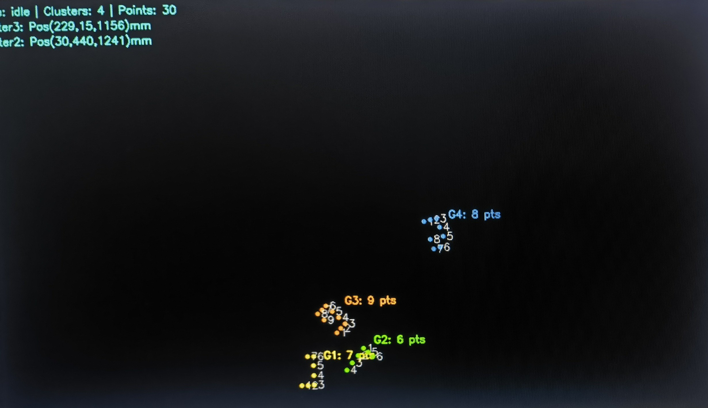
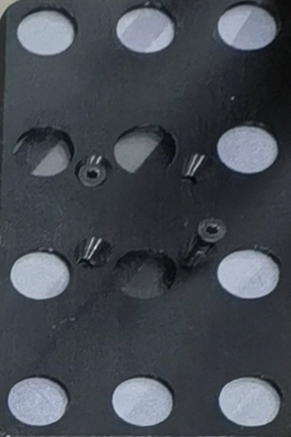
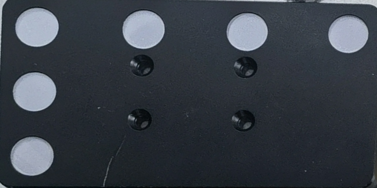

# 红外靶板位姿估计

使用**单目红外相机**识别平面靶板上的反光圆点，通过相机内参和圆点的实际毫米坐标计算靶板相对于相机的三维位置与姿态。本项目从 `InfraredCamera(1)` 的红外靶板定位功能中独立而来，不使用深度相机。



图中是原系统的实机画面。独立项目会显示实心靶点、编号、簇标签、左上角状态与位姿信息，并可输出 JSON 位姿数据。

## 项目结构

```text
ir-target-pose-estimation/
├─ assets/                         # README 使用的现场图和靶板正视图
│  ├─ detection_result.jpg         # 原系统的多靶板红外检测效果
│  ├─ board_gun_front.png          # 枪上靶板可见光正视图
│  ├─ board_center_front.png       # 中间靶板可见光正视图
│  └─ board_l6_front.png           # 6 点 L 形靶板可见光正视图
├─ configs/                        # 相机、检测和靶板配置
│  ├─ config.example.json          # 相机连接、阈值及 PnP 参数示例
│  ├─ boards.example.json          # 靶点毫米坐标及预览颜色示例
│  └─ camera_calibration.yml       # 原项目相机内参与畸变参数
├─ ir_target_pose/                 # 红外靶板位姿估计 Python 包
│  ├─ __init__.py                  # 包初始化
│  ├─ __main__.py                  # capture-calibration、calibrate、detect、live 命令入口
│  ├─ camera.py                    # 红外相机连接、设备选择与采集
│  ├─ calibration.py               # 棋盘格标定及 YAML 读写
│  ├─ settings.py                  # JSON 配置、靶板点位与颜色加载
│  ├─ spots.py                     # 阈值分割及亮点中心提取
│  ├─ geometry.py                  # 亮点聚类、L/C 形点位排序
│  ├─ pose.py                      # PnP 位姿、旋转矩阵和三轴角度
│  ├─ pipeline.py                  # 单帧识别与位姿计算流程
│  └─ visualization.py             # 实心靶点、簇标签、状态文字与坐标轴
├─ .gitignore                      # 排除虚拟环境、采集结果和本机配置
├─ pyproject.toml                  # 包元数据及安装依赖
├─ requirements.txt                # 基础运行依赖清单
└─ README.md                       # 使用说明
```

## 配置文件与可修改参数

仓库提供 `configs/config.example.json` 和 `configs/boards.example.json`。首次使用时复制为本机配置 `configs/config.json`、`configs/boards.json`；这两个本机文件已被 `.gitignore` 排除。

- `configs/config.json`：相机连接、亮点检测、PnP 阈值及其他配置文件的路径。
- `configs/boards.json`：`L6`、`C7`、`C8`、`C9` 的**有序**圆心坐标，单位为毫米；`colors_bgr` 设置预览颜色，采用 OpenCV 的 BGR 顺序，例如 `[0, 255, 0]` 为绿色。
- `configs/camera_calibration.yml`：相机内参 `K` 和畸变参数 `D`。仓库自带文件来自原项目，**未记录标定图像尺寸**；只有确认相机、镜头和分辨率一致时才能直接使用，否则应重新标定。

`configs/config.json` 中最常调整的参数：

- `camera`：相机序号、后端、分辨率、帧率、曝光、设备名。
- `detection.threshold`：亮点二值化阈值；`min_area`、`max_area`、`min_radius`、`max_radius`、`min_circularity`：亮斑尺寸和形状过滤。
- `detection.cluster_eps`、`min_cluster_points`：亮点分组距离和最少点数。
- `pose.ransac_reprojection_error_px`、`max_reprojection_error_px`：PnP 的重投影误差限制。
- `calibration_file`、`boards_file`：相机 YAML 与靶板 JSON 路径；相对路径以 `configs/` 为基准。复制靶板配置后，将 `boards_file` 改为 `boards.json`。

## 靶板示例与要求

下面三张正视图由现场**可见光照片**透视校正得到，用于说明板体和孔位；它们不代表红外相机下的亮点效果。可见光下发白的孔位不一定反射所用波段的红外光。

### 9 点环形靶板



### 6 点 L 形靶板



制作或更换靶板时，请核对：

1. 有效圆点在相机和补光灯使用的近红外波段下足够亮，板体与安装孔保持暗；**以实际红外画面确认有效点数**，不要按可见光照片数孔。
2. 圆点固定在同一刚性平面上。圆心、点间距、点序须与 `configs/boards.json` 中的毫米坐标一致；仅凭上述照片无法获得可靠的加工尺寸。
3. 工作距离和倾角下，亮斑应彼此分离。强反光、粘连、遮挡、漏点会影响分组及位姿求解。
4. 更换板型需修改模板坐标；更换相机、镜头或实际成像分辨率需重新核对相机内参。

## 依赖

- **Python ≥ 3.10**。
- **NumPy ≥ 1.24**：数组与几何计算。
- **opencv-python ≥ 4.8**：相机采集、图像处理、棋盘格标定、PnP 和预览窗口。
- **pygrabber ≥ 0.2（可选）**：仅在 Windows 上通过 `device_name` 选择 DirectShow 相机时使用。
- **setuptools ≥ 68**：执行 `pip install -e .` 时的构建依赖。

基础运行依赖写在 `pyproject.toml` 和 `requirements.txt`；`pygrabber` 对应 `windows-camera-name` 可选依赖。无需 PyTorch 或深度模型。

## 快速运行

以下命令在 **Windows PowerShell** 中、从项目根目录执行。开始前请先阅读上面的目录、配置和靶板要求；需要 Python 3.10 或更新版本、OpenCV 可读取的红外相机，以及与相机波段匹配的照明及靶板。

### 1. 安装依赖并建立本机配置

```powershell
python -m venv .venv
.\.venv\Scripts\Activate.ps1
python -m pip install -e .
Copy-Item configs/config.example.json configs/config.json
Copy-Item configs/boards.example.json configs/boards.json
```

将 `configs/config.json` 中的 `boards_file` 改为 `boards.json`。

### 2. 连接红外相机

在 `configs/config.json` 中修改 `camera`，例如：

```json
"camera": {
  "index": 1,
  "backend": "msmf",
  "width": 1920,
  "height": 1080,
  "fps": 30,
  "exposure": null,
  "device_name": null
}
```

- `index`：OpenCV 的相机序号，通常从 `0` 开始；按实际连接的设备调整。
- `backend`：可选 `msmf`、`dshow`、`any`；示例配置使用 `msmf`。
- `width`、`height`、`fps`：向驱动请求的分辨率和帧率。驱动可能不接受请求值，使用前要核对实际输出。
- `exposure`：`null` 表示不修改；固定曝光时填相机驱动接受的值。
- `device_name`：按设备名选相机时，先安装 `python -m pip install -e ".[windows-camera-name]"`，把 `backend` 设为 `dshow`，再填可唯一匹配的设备名；否则保持 `null`，使用 `index`。

打开实时预览检查连接，按 `q` 退出：

```powershell
python -m ir_target_pose --config configs/config.json live
```

**运行入口是 `ir_target_pose/__main__.py`，统一用 `python -m ir_target_pose` 调用。**相机连接实现位于 `camera.py`，不需要直接运行该文件。

### 3. 标定红外相机内参

仓库的 `configs/camera_calibration.yml` 来自原项目，包含 `K` 和 `D`，但**未记录标定时的图像尺寸**。只有确认它与当前相机、镜头和分辨率匹配时才能直接使用；否则请重新标定。

先用**棋盘格标定板**采集不同位置、不同倾角的图像。预览窗口中按空格保存，按 `q` 退出：

```powershell
python -m ir_target_pose --config configs/config.json capture-calibration --directory captures
```

再运行标定；`--columns`、`--rows` 是棋盘格的**内部角点数**，`--square-mm` 是实测方格边长，下面数值仅为命令示例：

```powershell
python -m ir_target_pose --config configs/config.json calibrate --images "captures/*.png" --columns 9 --rows 6 --square-mm 20
```

命令调用 `ir_target_pose/calibration.py`，将 `K`、`D` 和图像尺寸写入 `configs/camera_calibration.yml`。**棋盘格用于相机内参标定；下面的圆点靶板用于位姿识别，两者不能互换。**

### 4. 配置靶板并识别

在 `configs/boards.json` 中核对 `L6`、`C7`、`C8`、`C9` 的圆心坐标，单位为毫米。示例点位沿用原项目布局；制作或更换靶板时必须按实物测量修改。`colors_bgr` 是各靶板的预览颜色，采用 OpenCV 的 **BGR** 顺序，例如 `[0, 255, 0]` 是绿色。

实时识别，按 `q` 退出；`--jsonl` 将每帧位姿写入文件：

```powershell
python -m ir_target_pose --config configs/config.json live --jsonl outputs/poses.jsonl
```

识别单张图像，在终端输出 JSON 并保存标注图：

```powershell
python -m ir_target_pose --config configs/config.json detect --image captures/target.png --output outputs/target_annotated.png
```

## 输出结果

`tvec_mm` 是靶板坐标系原点在相机坐标系中的位置，单位为毫米；`rvec`、`rotation_matrix` 表示靶板到相机的旋转；`euler_xyz_deg` 按原程序 **ZYX 顺序**给出 X/Y/Z 角度（滚转、俯仰、偏航），单位为度；`reprojection_error_px` 是平均重投影误差。预览左上角的 `Pos`、`RotXYZ` 对应这些结果。

## 当前范围

本项目提供红外亮点检测、靶板分组、单目 PnP 位姿解算及预览。枪头标定、枪头跟踪、RGB 来料偏差识别和原项目的完整控制界面不包含在这个独立项目中。

## 额外说明：靶点对应关系与适用范围

开发过程中尝试过先用已知模板匹配检测点，再通过单应性变换、最近邻或 RANSAC 建立对应关系。早期的 11 点靶板方案还尝试过在匹配后用 PnP 补全和验证点位；实际调试出现过角点提取异常、模板与检测点数量不一致、退化投影，以及结果随帧明显跳变等问题，未形成可直接用于本项目的稳定通用匹配方案。6 点 L 形靶板也尝试过固定角度分组、邻点找拐角等排序规则，在旋转视角下仍会误判。

因此，当前实现先检测并聚类亮点，按每簇的点数区分 `L6`、`C7`、`C8`、`C9`，再按这些**固定靶板的几何特征**排序，最后将已排序的图像点与配置中的毫米坐标对应，用 PnP 计算位姿。这里舍弃的是未能稳定建立点位对应关系的通用模板匹配尝试，**PnP 仍用于位姿求解**。

`ir_target_pose/geometry.py` 的排序规则专门针对现有四种靶板：`L6` 使用四点长边和两点短边，`C7`、`C8`、`C9` 使用开口点与邻点顺序；`pipeline.py` 也只接收 6、7、8、9 点簇。**它不是任意 3×4 圆点组合的通用识别器。**即使另一个靶板也有 6～9 个红外亮点，仅修改 `configs/boards.json` 的坐标也不能保证点序正确；要支持新布局，必须实现相应的板型判别和排序规则，并用实际拍摄的不同旋转、倾角图像验证点序与位姿。
